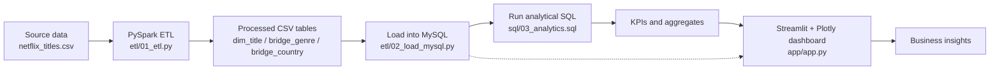
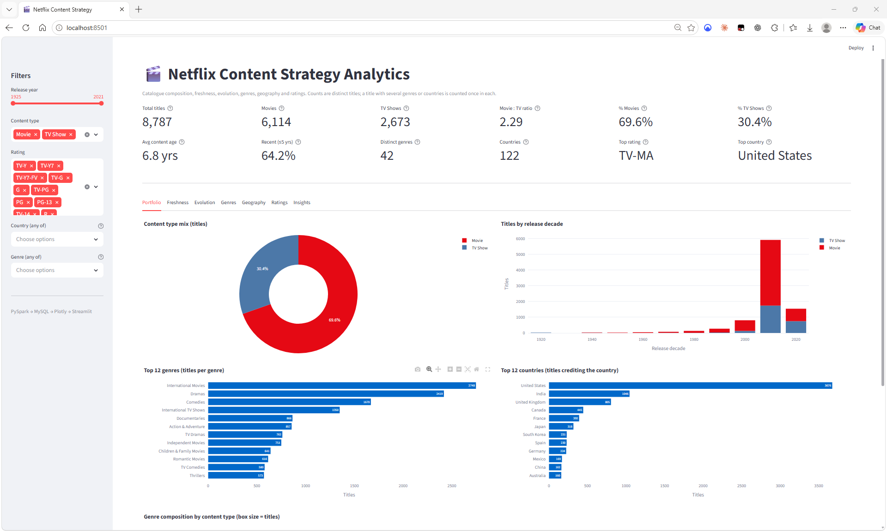
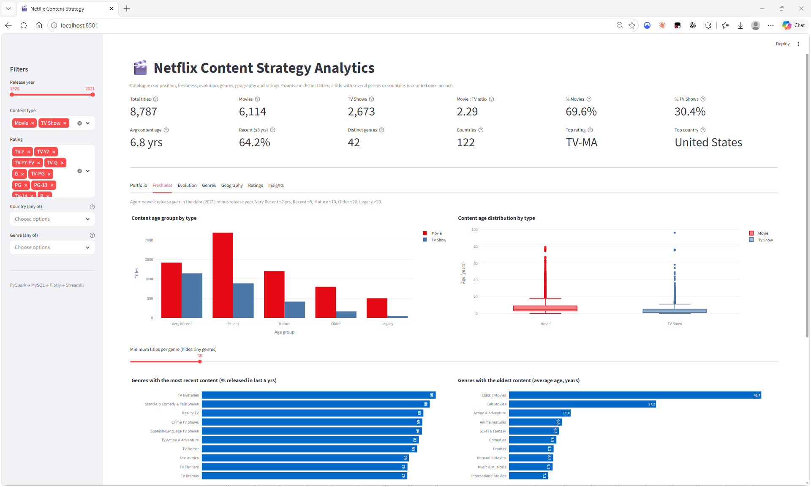
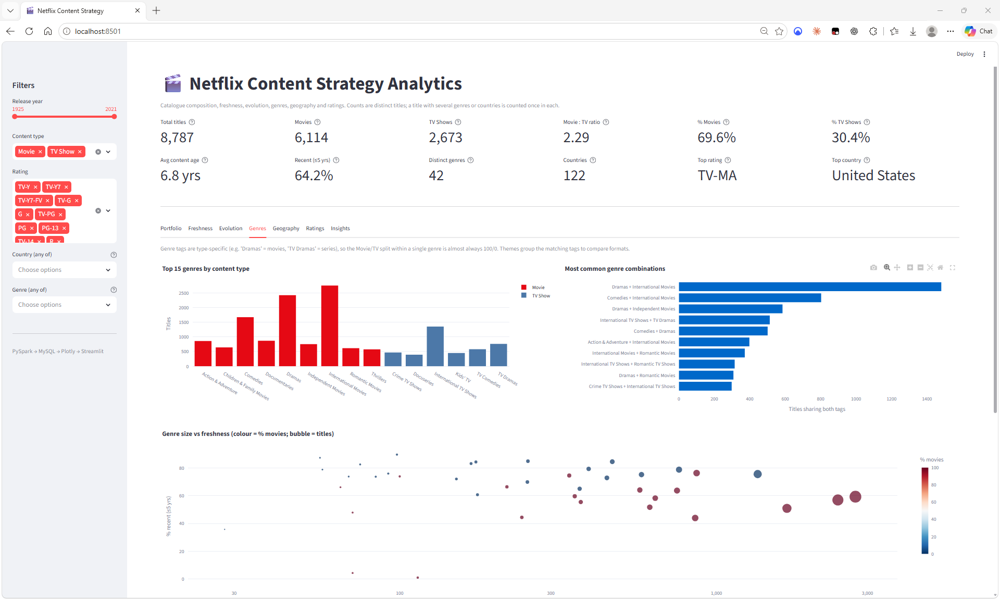
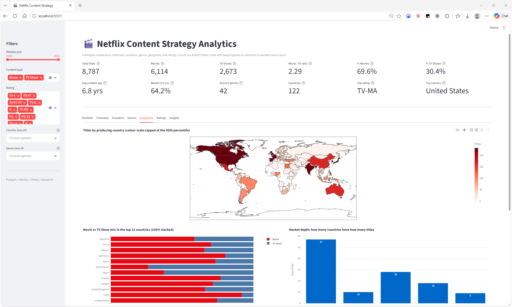
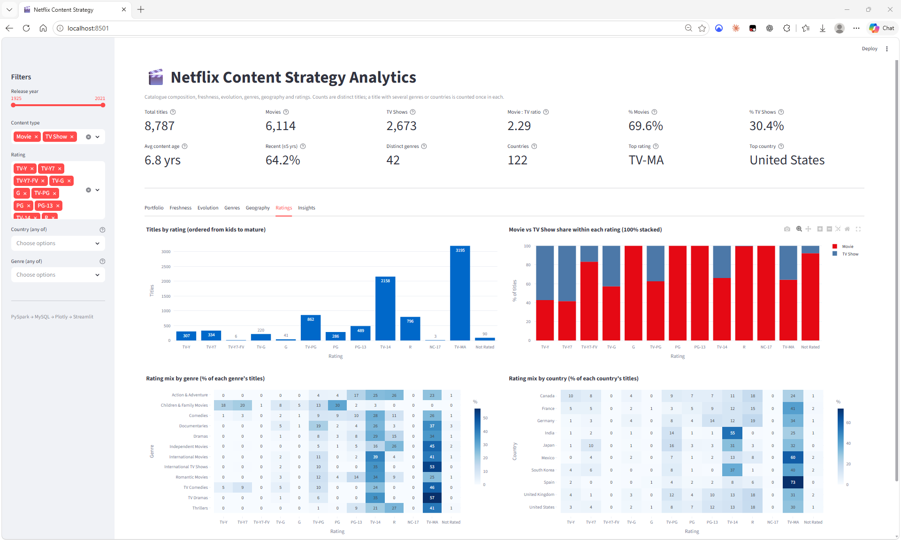
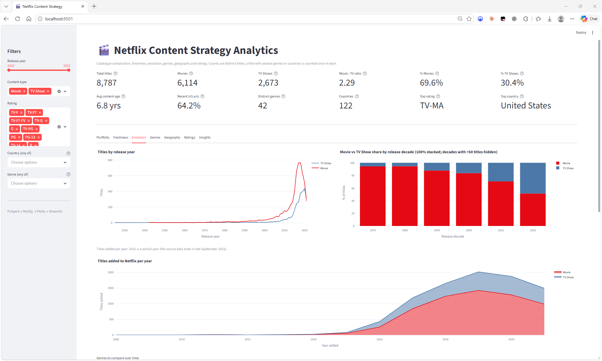
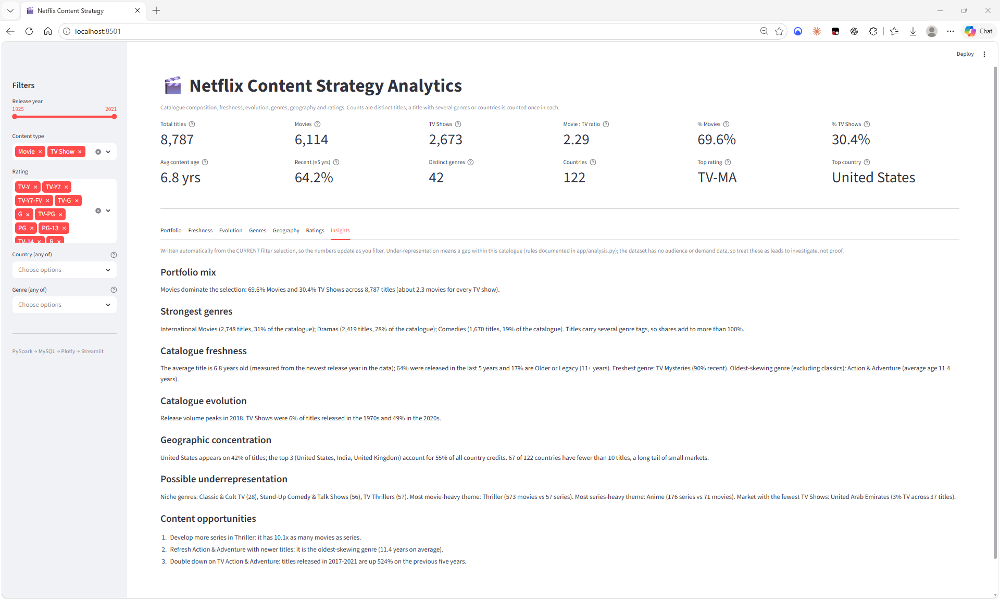

# Netflix Content Strategy Analytics

8,787 titles: 69.6% Movies / 30.4% TV Shows, average content age 6.8 years, 64.2% released in the last 5 years, 42 genres, 122 countries.

An end-to-end data analytics project exploring Netflix's content portfolio, freshness, genre distribution, geographic reach, ratings, and release trends.

The project combines **PySpark, Python, MySQL, SQL, Plotly, and Streamlit** to transform raw title data into analytical datasets, validate the underlying data model, and present findings through an interactive dashboard.

## Pipeline Architecture



## Dashboard Preview

### 1. Content Portfolio

Explore the composition of Netflix's catalogue, including the distribution of movies and TV shows.



### 2. Content Freshness

Examine content age and the distribution of titles by freshness, including the identification of recent content.



### 3. Genre Intelligence

Explore genre representation across the catalogue and understand how titles are distributed across content categories.



### 4. Geographic Analysis

Examine the geographic distribution of Netflix titles and the representation of countries in the catalogue.



### 5. Ratings Analysis

Analyse the distribution of titles across content ratings.



### 6. Content Evolution

Explore how the composition of the catalogue changes across release decades.



### 7. Key Insights

Review the analytical findings surfaced through the dashboard.



---

## Project Overview

Netflix's catalogue contains titles with different formats, release periods, genres, countries of production, and content ratings. Analysing these attributes requires more than aggregating rows: the data model must account for titles that have multiple genre or country associations.

This project builds an analytics workflow that prepares the data, stores analytical tables, calculates KPIs, validates data consistency, and presents the results through an interactive dashboard.

The focus is on connecting data engineering and analytical modelling with practical content-strategy questions.

## Key Analytical Areas

| Area | Analytical focus |
|---|---|
| Content Portfolio | Catalogue composition and the distribution of movies and TV shows |
| Content Freshness | Content age and the identification of recent titles |
| Genre Intelligence | Genre distribution and title-to-genre associations |
| Geographic Analysis | Country-level representation in the catalogue |
| Ratings | Distribution of titles across content ratings |
| Content Evolution | Changes in catalogue composition across release decades |
| Key Insights | Consolidated findings derived from the analytical datasets |

## Technology Stack

| Technology | Role |
|---|---|
| PySpark | Data preparation and ETL transformations |
| Python | Pipeline scripts, analysis, and validation |
| pandas | Tabular data manipulation |
| MySQL | Analytical data storage |
| SQL | KPI calculations and analytical queries |
| Plotly | Interactive visualisations |
| Streamlit | Dashboard interface |
| Git and GitHub | Version control and project publication |

## Repository Structure

```text
.
├── app/
│   ├── analysis.py
│   └── app.py
├── data/
│   └── processed/
├── docs/
│   ├── evolution.png
│   ├── freshness.png
│   ├── genres.png
│   ├── geography.png
│   ├── insight.png
│   ├── portfolio.png
│   └── ratings.png
├── etl/
│   ├── 01_etl.py
│   ├── 02_load_mysql.py
│   └── 03_run_sql.py
├── sql/
│   └── 03_analytics.sql
├── tests/
│   └── validate_grain.py
├── .gitignore
├── .env.example
├── README.md
└── requirements.txt
```

### Directory responsibilities

- **`app/`** — dashboard application and analytical logic.
- **`data/processed/`** — generated datasets used by the analytical workflow.
- **`docs/`** — dashboard screenshots used in this documentation.
- **`etl/`** — data preparation, MySQL loading, and SQL execution scripts.
- **`sql/`** — analytical SQL queries and table definitions.
- **`tests/`** — data-model and analytical validation checks.
- **`reference/`** — reference solution materials retained locally and excluded from version control.

Generated datasets under `data/processed/` are excluded from version control to avoid committing derived data files unnecessarily.

## Data Pipeline

The project separates data preparation, storage, analytics, and visualisation into distinct stages.

### Stage 1 — Data Preparation

**Script:** `etl/01_etl.py`

The ETL stage prepares the Netflix title data for analysis. The analytical features include content age, freshness classification, release-decade grouping, and content-age groups.

### Stage 2 — MySQL Loading

**Script:** `etl/02_load_mysql.py`

The loading stage transfers the prepared analytical data into MySQL for structured querying and downstream analysis.

### Stage 3 — SQL Analytics

**Script:** `etl/03_run_sql.py`

The SQL execution stage runs the analytical queries defined in `sql/03_analytics.sql`.

The analytics support title-level KPIs and analysis across genres, countries, ratings, and release periods.

### Stage 4 — Analysis and Visualisation

**Files:** `app/analysis.py` and `app/app.py`

The application uses the prepared analytical data to power a Streamlit dashboard with Plotly visualisations.

The dashboard provides an interactive interface for exploring the catalogue through multiple analytical perspectives.

## Data Model and Analytical Grain

An important consideration in this project is the distinction between a **title** and a **title-associated record**.

A single Netflix title can belong to multiple genres and can be associated with multiple countries. Consequently, a dataset containing exploded genre or country associations can contain several rows for one title.

Counting those association rows as unique titles would inflate catalogue-level KPIs.

The project therefore distinguishes between title-level measures and association-level measures.

### Title-level metrics

Title-level counts use distinct title identifiers:

```sql
COUNT(DISTINCT show_id)
```

This ensures that a title associated with multiple genres or countries is counted only once in catalogue-level totals.

### Association-level metrics

Genre and country analyses account for the fact that individual titles may have multiple associations.

Association counts can legitimately exceed the number of unique titles. These measures should not be interpreted as distinct-title counts.

This distinction is important for maintaining consistency between the dashboard's overall KPIs and its category-level analyses.

## Data Validation

The project includes a validation script that checks the consistency of the analytical datasets.

Run the checks from the project root:

```powershell
python tests\validate_grain.py
```

**Validation result: 12 of 12 checks passed.**

The checks cover the following areas:

| # | Validation check | Purpose |
|---:|---|---|
| 1 | One row per `show_id` in `dim_title` | Verifies title-level grain |
| 2 | `kpi_summary` total matches `dim_title` | Reconciles catalogue-level totals |
| 3 | Movies plus TV shows equal total titles | Verifies content-type reconciliation |
| 4 | Genre credits are greater than or equal to titles | Accounts for multiple genre associations |
| 5 | Every genre row has a parent title | Checks referential integrity |
| 6 | Every country row has a parent title | Checks referential integrity |
| 7 | No empty country values | Checks geographic data completeness |
| 8 | All five content-age groups are populated | Checks content-age classification |
| 9 | No duration text remains in the rating column | Checks rating-field cleanup |
| 10 | Content age is never negative | Checks content-age validity |
| 11 | `is_recent` agrees with `content_age <= 5` | Checks freshness-classification consistency |
| 12 | Decade-level content-type shares sum to approximately 100% | Checks decade-level percentage calculations |

These checks provide evidence that the analytical datasets satisfy the project's defined structural and consistency rules.

## Key Design Decisions
- Content age is measured from the newest release year in the data (2021), not today's date. Using
  today's date left the "Very Recent" group empty because the dataset ends in 2021.
- All release years are kept; filtering to 2008+ would hide the old content the freshness analysis needs.
- Three rows had a duration (for example "74 min") in the rating column; they were moved back to the
  duration column. NR, UR and missing ratings were merged into "Not Rated".
- Netflix genre tags are type-specific ("Dramas" = movies, "TV Dramas" = series), so the Movie vs TV split
  inside one genre is almost always 100/0. app/analysis.py groups equivalent tags into themes (Drama,
  Comedy, Thriller and so on) to compare formats fairly.
- Country analysis uses all listed countries (bridge_country); primary country is the first listed.

## Results (whole catalogue)
8,787 titles: 69.6% Movies and 30.4% TV Shows (2.29 movies per TV show). Average content age 6.8 years;
64.2% released in the last 5 years. 42 genres and 122 countries. Top rating TV-MA; top country United
States. The dashboard's Insights tab adds filter-aware findings on freshness, evolution, market
concentration and possible gaps.

## Limitations
- The data has no audience, viewing or revenue figures, so "underrepresented" means a gap inside the
  catalogue, not proven unmet demand.
- The results use the course-provided copy of the dataset, in which 20 of 8,807 rows had malformed fields (no release year) and are excluded, leaving 8,787 titles. Counts from a different copy of the data may differ slightly.
- The source data ends in September 2021, so 2021 is a partial year in "titles added per year".

## Getting Started

On macOS/Linux use `cp .env.example .env`, `mkdir -p data/processed` and forward slashes in paths.

### Prerequisites

Before running the project, ensure that you have:

- Python 3.10+
- Java 17 (required by PySpark)
- MySQL 8, running locally
- The Netflix titles dataset ("Netflix Movies and TV Shows" on Kaggle), saved as `data/netflix_titles.csv`. The results below come from the course-provided cleaned copy of this dataset.

### 1. Clone the repository

```powershell
git clone https://github.com/IpsitMohanty/netflix-content-strategy.git
cd netflix-content-strategy
```

### 2. Create a virtual environment

```powershell
python -m venv .venv
.\.venv\Scripts\Activate.ps1
```

### 3. Install dependencies

```powershell
python -m pip install -r requirements.txt
```

The project's dependency file includes:

- `pyspark>=3.5,<4`
- `pandas>=2.0`
- `sqlalchemy>=2.0`
- `pymysql>=1.1`
- `cryptography>=42`
- `python-dotenv>=1.0`
- `plotly>=5.20`
- `streamlit>=1.35`

### 4. Configure MySQL

Copy `.env.example` to `.env`:

```powershell
copy .env.example .env
```

Put your MySQL password in `.env`. The `.env` file is git-ignored and must never be committed.

### 5. Create the processed-data directory

```powershell
mkdir data\processed
```

### 6. Run the ETL pipeline

From the project root, execute the scripts in the intended order:

```powershell
python etl\01_etl.py
python etl\02_load_mysql.py
python etl\03_run_sql.py
```

The ETL input is `data/netflix_titles.csv`.

### 7. Run the validation checks

```powershell
python tests\validate_grain.py
```

The validation script checks the structure and consistency of the analytical datasets.

### 8. Launch the dashboard

```powershell
python -m streamlit run app/app.py
```

The dashboard depends on the data and database configuration expected by the application. Ensure those prerequisites are satisfied before launching it.

On Windows, use `python -m pip` and `python -m streamlit` so dependency installation and the dashboard use the same Python interpreter.

## Dependencies

Dependencies are maintained in [`requirements.txt`](requirements.txt).

The project uses version constraints rather than a fully pinned dependency lockfile. For reproducible execution across different environments, dependency compatibility should be verified against the Python version and local MySQL setup.

## Configuration and Version Control

The repository excludes local secrets and generated data from version control.

- `.env` — local configuration; do not commit credentials.
- `.venv/` — local Python virtual environment.
- `data/processed/` — generated analytical datasets.
- `reference/` — retained reference solution materials.

The dashboard screenshots are maintained under `docs/` and referenced using relative paths so that they render directly in the GitHub README.

## Project Objective

This project demonstrates an end-to-end analytics workflow connecting data engineering, relational data modelling, SQL-based analysis, data validation, and interactive visualisation.

By explicitly accounting for data grain and validating analytical relationships, the workflow aims to produce catalogue-level metrics that remain consistent while supporting deeper exploration of Netflix's content portfolio.